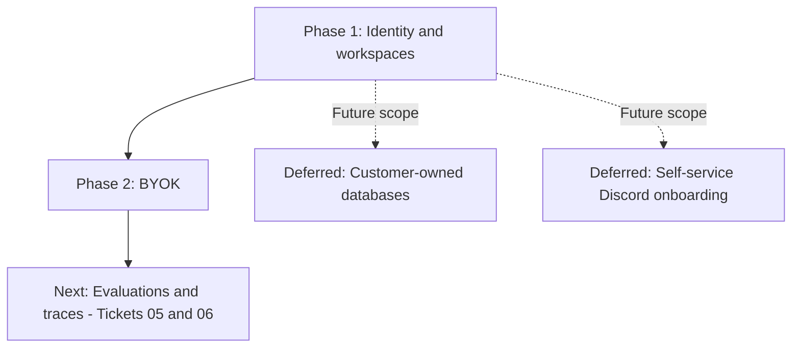

# Thread Agent V2: Ordered Implementation Plan

**Scope**: Multi-tenant Organizational Memory Portfolio Demonstration

**Baseline PRD**: [`PRD_V2.md`](../PRD_V2.md)

**Technical Spec**: [`specs/V2_SPEC.md`](V2_SPEC.md)

---

## 1. Plan Overview & Dependency Graph

Revised on 2026-10-28: the active demo sequence is **Phase 1 → Phase 2 → original Phase 5**. Phase 1 and Phase 2 are implemented with documented live-verification gaps. Customer-owned databases (Phase 3) and self-service Discord onboarding (Phase 4) are deferred. Retain original numbers and ticket IDs for continuity. Use managed memory and the existing configured Discord integration.



Current demo storage: configured managed PostgreSQL/pgvector. Current Discord:
existing installation and server-owned channel policies. Evaluations must retain
tenant and source isolation; traces must retain conversation ownership checks.
Fixture imports for a second workspace do not imply a second Discord installation.

---

## 2. Phase-by-Phase Execution Order

### Phase 1: Tenant & Identity Foundation (`specs/tickets/01_V2-01_workspaces_and_membership.md`)
1. **Migration & Schema**:
   - Create `backend/app/data/migrations/020_v2_identity_and_tenants.sql` for `users`, `organizations`, `memberships`, `invitations`, `assistant_configurations`.
   - Seed `gdg_mcet` as an explicit persistent workspace fixture.
2. **Backend Authentication & Workspace APIs**:
   - Implement `backend/app/api/v2/auth.py` (signup, login, me, logout).
   - Implement `backend/app/api/v2/organizations.py` (create, list, switch, invite, accept, update role, remove member, ownership transfer).
   - Enforce strict server-side checks via FastAPI dependency `get_current_membership`.
   - Remove fallback logic in `organizations.py` and `membership.py`; unknown org IDs raise `OrganizationNotFoundError` (HTTP 404).
3. **Generic Assistant Configuration**:
   - Remove hardcoded community keywords (`gdg`, `mcet`, `devfest`) from `workflow.py`.
   - Implement default general memory assistant with optional custom specialist roles.
4. **Frontend Workspaces**:
   - Add `WorkspaceSwitcher` and `WorkspaceSettingsPage` (manage members, invite teammates).
5. **Phase 1 Verification**:
   ```bash
   backend\.venv\Scripts\python.exe -m pytest backend/tests/test_v2_identity_and_tenants.py
   ```

---

### Phase 2: Bring Your Own Model Key (`specs/tickets/02_V2-02_bring_your_own_key.md`)
1. **Encryption Core**:
   - Create migration `backend/app/data/migrations/021_v2_model_credentials.sql`.
   - Implement AES-256-GCM symmetric encryption in `backend/app/core/crypto.py` using `THREAD_MASTER_ENCRYPTION_KEY`.
2. **BYOK Endpoints**:
   - Implement `backend/app/api/v2/credentials.py` (POST test & save, GET masked status, DELETE key).
3. **Dynamic Model Instantiation**:
   - Update `workflow.py` to resolve model clients dynamically using decrypted credentials in `TenantContext`.
   - Lock embedding configuration (`gemini-embedding-001`, 768-dim) separately from chat/reasoning models.
   - Extract and record token usage metrics (provider-reported vs. estimated).
4. **Frontend BYOK Settings**:
   - Add `BYOKSettingsCard` component to `WorkspaceSettingsPage`.
5. **Phase 2 Verification**:
   ```bash
   backend\.venv\Scripts\python.exe -m pytest backend/tests/test_v2_byok_credentials.py
   ```

---

### Deferred Phase 3: Memory Storage Selection (`specs/tickets/03_V2-03_memory_storage_selection.md`)
1. **Schema & Ownership Definition**:
   - Create migration `003_v2_storage_configurations.sql`.
   - Formalize boundary: Service DB holds only metadata; Memory DB holds chunks, vectors, conversations, turns, and traces.
2. **SSRF & Network Security Validator**:
   - Implement `backend/app/core/network_security.py` with DNS resolution checks, loopback/private/cloud metadata blocking (IPv4 & IPv6), TLS enforcement, and socket connect pinning.
3. **Customer Database Pre-Flight & Migration**:
   - Implement `backend/app/memory/customer_db_manager.py` (connection test, `pgvector` check, DDL runner).
4. **Dynamic Connection Pooling & Zero-Fallback Policy**:
   - Implement `TenantConnectionManager` pooling async connections per tenant.
   - Enforce zero fallback: if customer DB is unreachable, immediately raise `TenantStorageUnavailableError`.
5. **Frontend Storage Card**:
   - Add `StorageSettingsCard` to `WorkspaceSettingsPage` with validation and schema initialization diff.
6. **Phase 3 Verification**:
   ```bash
   backend\.venv\Scripts\python.exe -m pytest backend/tests/test_v2_storage_selection.py
   ```

---

### Deferred Phase 4: Self-Service Discord Ingestion (`specs/tickets/04_V2-04_self_service_discord.md`)
1. **Integrations Schema**:
   - Create migration `004_v2_discord_integration.sql` (`platform_installations`, `channel_configurations`, `ingestion_jobs`).
2. **OAuth Flow & Guild Binding**:
   - Implement OAuth flow in `backend/app/api/v2/discord.py`, cryptographically binding the Discord guild to the authenticated `organization_id`.
3. **Channel Selection & Bounded Ingestion**:
   - Implement channel selection endpoints with explicit classification (`public_community` vs `internal_team`).
   - Implement `DiscordIngestionService` with checkpointing and idempotent deduplication `(org_id, guild_id, channel_id, message_id)`.
4. **Lifecycle & Outbound Delivery Safety**:
   - Process `MESSAGE_UPDATE` (re-chunk/re-index) and `MESSAGE_DELETE` (deactivate chunks).
   - In `backend/app/channels/outbound.py`, verify destination channel classification: never post internal evidence to public Discord channels.
   - Implement Disconnect and Purge data actions.
5. **Frontend Integration Card**:
   - Add `DiscordIntegrationCard` to `WorkspaceSettingsPage`.
6. **Phase 4 Verification**:
   ```bash
   backend\.venv\Scripts\python.exe -m pytest backend/tests/test_v2_discord_integration.py
   ```

---

### Implemented demo phase (original Phase 5): Evaluation, Security Gates & Traces (`specs/tickets/05_V2-05_...` & `06_V2-06_...`)
1. **Multi-Tenant Evaluation Dataset**:
   - Create `backend/tests/fixtures/eval_v2_dataset.json` with 30+ versioned questions across Tenant 1 (GDG MCET) and Tenant 2 (Synthetic Tech Org).
2. **Evaluation Benchmark CLI**:
   - Create `scripts/run_eval_v2.py` comparing vector-only vs. hybrid (dense embedding + `tsvector` with Reciprocal Rank Fusion) reporting Recall@k, MRR, citation precision, and latency.
3. **Security Isolation Regression Suite**:
   - Implement `backend/tests/test_v2_security_isolation.py` (cross-tenant canary checks, pre-retrieval scope filtering, prompt injection defense, and secret regex redaction).
4. **Conversation-Scoped Observable Tracing**:
   - Add the next migration in `backend/app/data/migrations` (expected `022_v2_execution_traces.sql`) targeting the configured managed memory database. Inspect/complete durable conversation identity and ownership before wiring trace access.
   - Implement `backend/app/api/v2/traces.py` enforcing conversation ownership / admin authorization.
   - Refusal summaries scrub inaccessible document titles, authors, and text snippets.
   - Update frontend `TraceInspector` to display the interactive timeline.
5. **Phase 5 Verification**:
   ```bash
   backend\.venv\Scripts\python.exe -m pytest backend/tests/test_v2_security_isolation.py
   backend\.venv\Scripts\python.exe -m pytest backend/tests/test_v2_execution_traces.py
   backend\.venv\Scripts\python.exe scripts/run_eval_v2.py --report eval_v2_report.json
   ```

---

## 3. Deliverable Tracking

| Ticket | Work Package | Dependencies | Verification Target |
|---|---|---|---|
| [`01_V2-01`](tickets/01_V2-01_workspaces_and_membership.md) | Identity, Workspaces & Membership | None | `test_v2_identity_and_tenants.py` |
| [`02_V2-02`](tickets/02_V2-02_bring_your_own_key.md) | BYOK & AES-256-GCM Encryption | Ticket 01 | `test_v2_byok_credentials.py` |
| [`03_V2-03`](tickets/03_V2-03_memory_storage_selection.md) | Customer PostgreSQL + SSRF Defense — deferred | Ticket 01, future scope | `test_v2_storage_selection.py` |
| [`04_V2-04`](tickets/04_V2-04_self_service_discord.md) | Self-service Discord — deferred; existing integration retained | Future scope | `test_v2_discord_integration.py` |
| [`05_V2-05`](tickets/05_V2-05_evaluation_and_security_gates.md) | Evaluation Benchmark & Isolation Gates — next | Tickets 01, 02; existing managed memory | `test_v2_security_isolation.py`, `run_eval_v2.py` |
| [`06_V2-06`](tickets/06_V2-06_observable_execution_traces.md) | Observable Traces & Trace Authorization — next | Tickets 01, 02; managed conversation persistence | `test_v2_execution_traces.py` |


## 4. Revised demo acceptance gate

- Two managed workspaces with isolated memberships, model keys and evidence.
- Existing Discord ingestion/query/delivery demonstrated using its current binding.
- Reproducible evaluation dataset and honest vector-only versus hybrid results.
- Inspectable, redacted traces with conversation-owner/admin authorization.
- Clear evidence of missing-information behavior and current permission boundaries.
- Documented setup and remaining live-verification gaps.

Customer-owned storage and self-service Discord onboarding are future capabilities,
not demo claims or blockers. Their original tasks above are retained for later.

## 5. Implementation handoff

Tickets 05/06 are implemented. Selected verification passed 89 checks with 41 opt-in checks skipped; the frontend builds. Read [implementation notes](EVALS_AND_TRACES_IMPLEMENTATION.md), [evaluation results](reports/eval_v2_report.md) and the root [codebase walkthrough](../CODEBASE_WALKTHROUGH.md). Live verification remains pending, and the offline report retains observed abstention failures.
